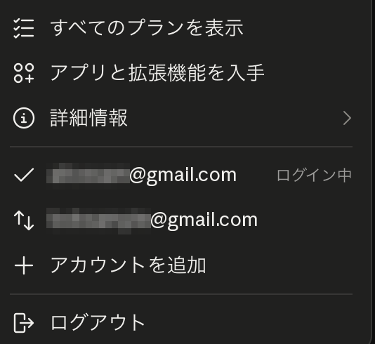

# Claude Account Switcher

claude.ai でサインアウトせずに複数アカウントを切り替えられる Chrome 拡張機能です。
画面左下のユーザーメニュー（アカウント名）に切り替え項目を追加します。

## 機能

- ユーザーメニューから保存済みアカウントへワンクリックで切り替え
- 「アカウントを追加」で現在のアカウントを保持したままログイン画面へ移動
- ログイン中のアカウントを表示
- 日本語・英語・中国語（簡体/繁体）・韓国語・スペイン語・フランス語・ドイツ語・ポルトガル語・ロシア語に対応

## インストール

1. [Releases](../../releases) から zip をダウンロードして展開する
2. `chrome://extensions` を開き、デベロッパーモードを有効にする
3. 「パッケージ化されていない拡張機能を読み込む」で展開したフォルダを選択する
4. 開いている claude.ai のタブを再読み込みする

## 使い方

1. claude.ai にログインし、ユーザーメニューの「アカウントを追加」をクリックする（現在のアカウントが保存され、ログイン画面に移動します）
2. 別のアカウントでログインする
3. 以降はユーザーメニューからアカウントを選択するだけで切り替わります

claude.ai でログアウトするとサーバー側でセッションが無効になるため、そのアカウントは一覧から削除されます。

## しくみ

アカウントごとに claude.ai の Cookie（Cloudflare 関連と端末 ID を除く）を `chrome.storage.local` に保存し、切り替え時に差し替えます。
サーバー側のログアウトは行わないため、保存したセッションは有効なまま残ります。

## 注意

- セッション Cookie はローカルストレージに平文で保存されます。共有 PC では使用しないでください。
- claude.ai の非公式ツールです。Anthropic とは関係ありません。
- サイトの仕様変更により動作しなくなる可能性があります。

## 権限

| 権限 | 用途 |
|---|---|
| `cookies` | claude.ai のセッション Cookie の保存・入れ替え |
| `storage` | アカウント情報の保存 |
| `scripting` | 現在のアカウントのメールアドレス取得 |
| `https://claude.ai/*` | 上記の対象サイト |

## ライセンス

[MIT](LICENSE)
